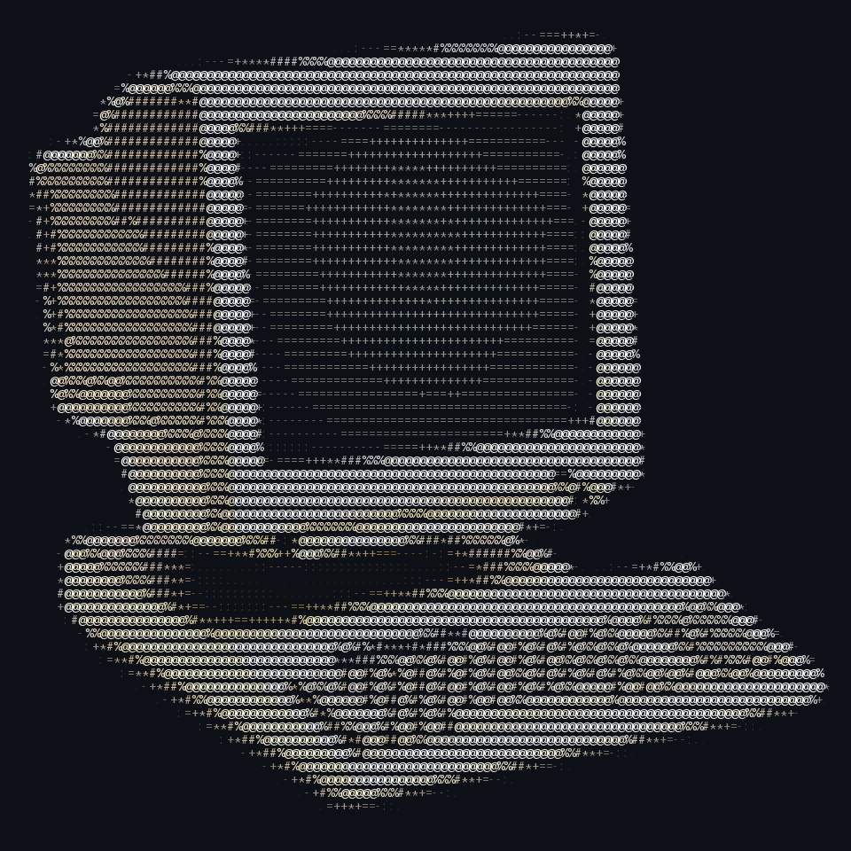
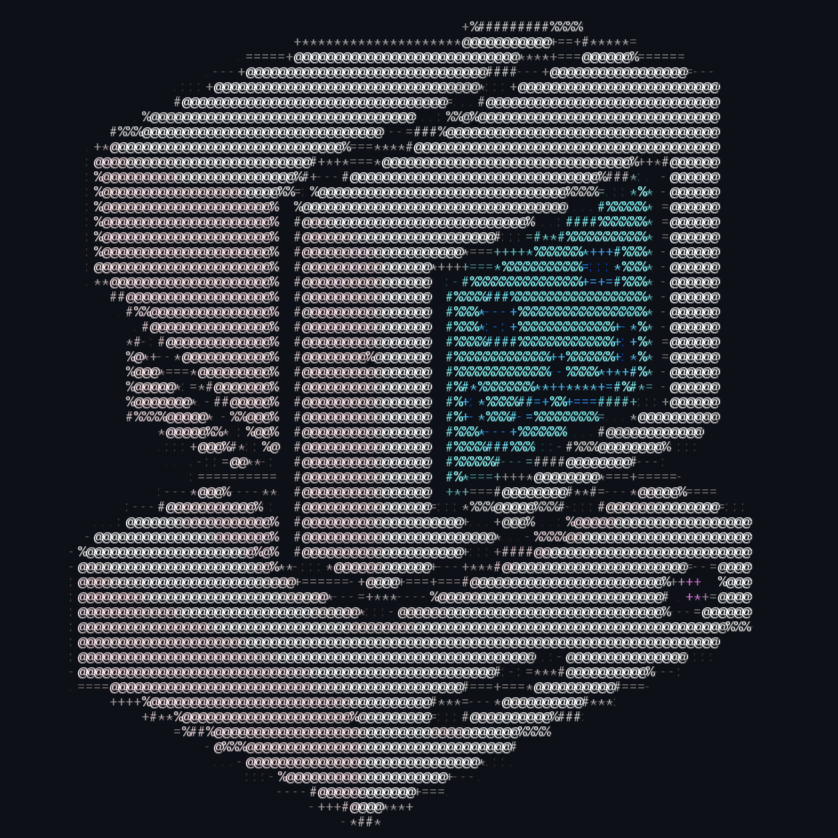
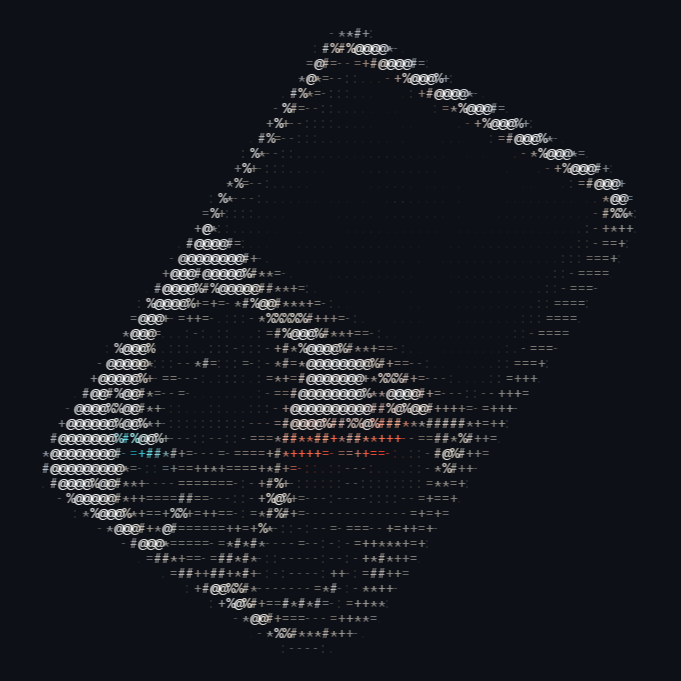

<!-- GRANDE BANNIÈRE GRANDIOSE -->

  

 

<!-- BOUTONS RÉSEAUX / IDENTITÉ -->

  
  

 

<!-- SECTION PRÉSENTATION PRINCIPALE -->
<table>
  <tr>
    <td width="65%" valign="top">
      <h3>🌸 Hey, moi c'est Jade !</h3>
      

        Actuellement en <b>bachelier en informatique</b>, dans la
        tech depuis le plus jeune age. 🌱
      

      <ul>
        <li>💻 <b>Domaine :</b> Développement Logiciel & Game Dev</li>
        <li>🎓 <b>Statut :</b> Étudiant en Informatique</li>
      </ul>
    </td>
    <td width="35%" align="center">
      
    </td>
  </tr>
</table>

 

<!-- CATEGORIE : LIEUX D'APPRENTISSAGE AVEC LOGOS -->
### 🚀 Cursus & Lieux d'apprentissage

<table width="100%">
  <tr>
    <td width="33%" align="center" valign="top">
       
      <b>Bachelier en Informatique</b> 
      analystes-programmeurs 
      réseau et télécommunication
    </td>
    <td width="33%" align="center" valign="top">
       
      <b>Codédex</b> 
      Développement & Quêtes
    </td>
    <td width="33%" align="center" valign="top">
       
      <b>TryHackMe</b> 
      Cybersécurité & Labs
    </td>
  </tr>
</table>

 

<!-- CATEGORIE : CENTRES D'INTÉRÊT -->
### 🪐 Centres d'intérêt

<table width="100%">
  <tr>
    <td width="25%" align="center" valign="bottom">
       
      <b>💻 Tech</b>
    </td>
    <td width="25%" align="center" valign="bottom">
       
      <b>🕷️ Spider-Man</b>
    </td>
    <td width="25%" align="center" valign="bottom">
       
      <b>🚀 Astronomie</b>
    </td>
    <td width="25%" align="center" valign="bottom">
       
      <b>🎧 Musique</b>
    </td>
  </tr>
</table>

 

<!-- TECH STACK -->
### 🛠️ Tech Stack & Compétences

  <b>Maîtrisés</b> 
  

  <b>En cours d'apprentissage</b> 
  

 

<!-- STATS GITHUB 3D (STYLE ISOMÉTRIQUE) -->
### 📊 GitHub Data & Activité 3D

  <!-- Graphique 3D isométrique des contributions (Généré par l'Action) -->
  

 

  <!-- Langages favoris en anneau discret -->
  

