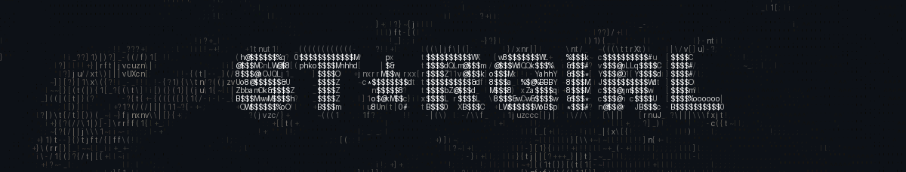
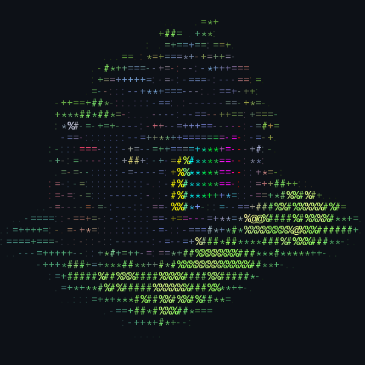
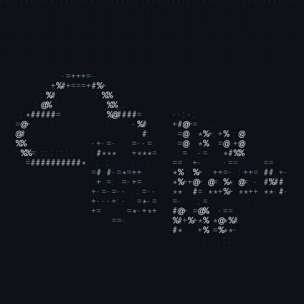
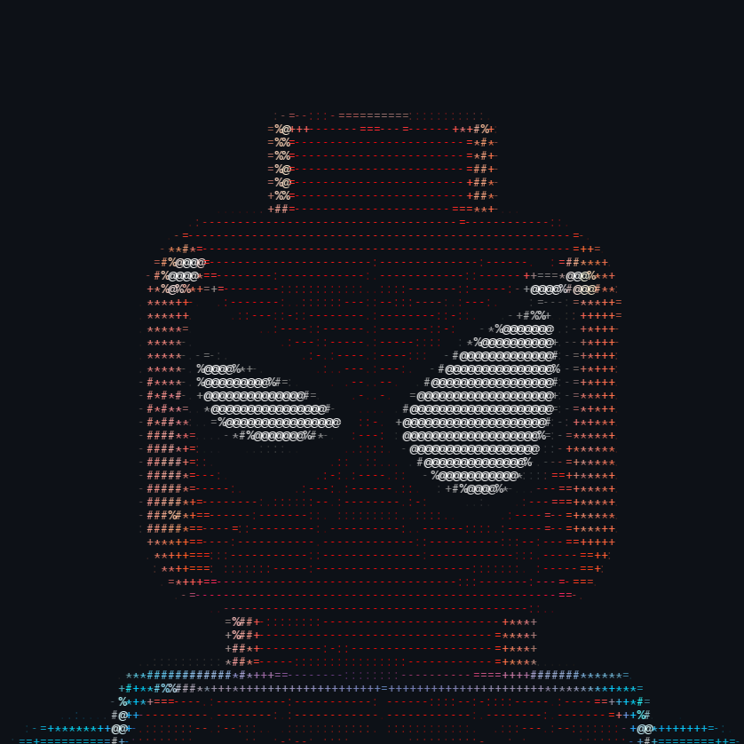
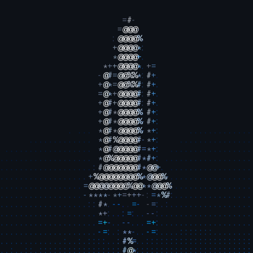

# 🌸 Hey, moi c'est Jade !

<!-- GRANDE BANNIÈRE GRANDIOSE -->

  

 

<!-- SECTION PRÉSENTATION PRINCIPALE -->

  <table>
    <tr>
      <td width="65%" valign="top">
        

          Actuellement en <b>bachelier en informatique</b>,  
          dans la tech depuis le plus jeune âge. 🌱
        

          
        <ul>
          <li>💻 <b>Domaine :</b> Développement Logiciel & Game Dev</li>
          <li>🎓 <b>Statut :</b> Étudiant en Informatique</li>
        </ul>
      </td>
      <td width="35%" align="center">
        
      </td>
    </tr>
  </table>

 

## 🚀 Cursus & Lieux d'apprentissage

  <table>
    <tr>
      <td width="33%" align="center" valign="top">
         
        <b>Bachelier en Informatique</b> 
        analystes-programmeurs 
        réseau et télécommunication
      </td>
      <td width="33%" align="center" valign="top">
         
        <b>Codédex</b> 
        Développement & Quêtes
      </td>
      <td width="33%" align="center" valign="top">
         
        <b>TryHackMe</b> 
        Cybersécurité & Labs
      </td>
    </tr>
  </table>

 

## 🪐 Centres d'intérêt

  <table>
    <tr>
      <td width="25%" align="center" valign="bottom">
         
        <b>💻 Tech</b>
      </td>
      <td width="25%" align="center" valign="bottom">
         
        <b>🕷️ Spider-Man</b>
      </td>
      <td width="25%" align="center" valign="bottom">
         
        <b>🚀 Astronomie</b>
      </td>
      <td width="25%" align="center" valign="bottom">
         
        <b>🎧 Musique</b>
      </td>
    </tr>
  </table>

 

## 🛠️ Tech Stack & Compétences

  <b>Maîtrisés</b> 
  

  <b>En cours d'apprentissage</b> 
  

 

## 📊 GitHub Stats

<!-- SCHEMA DE CONTRIBUTIONS 2D NATIF -->

  

